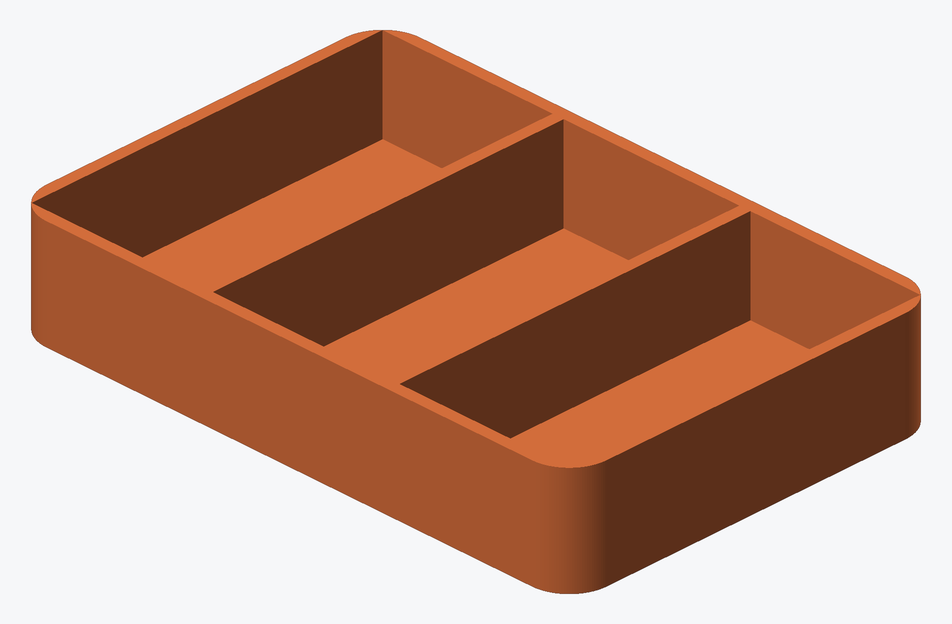
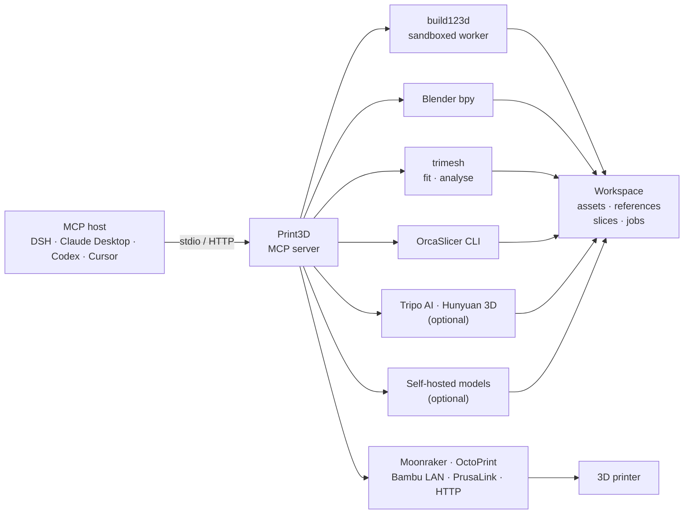

<div align="center">

# Print3D

**Self-hosted 3D printing MCP server — from prompt to printed part.**

Turn a sentence or an image into a part running on your printer.
Modelling, preview, slicing and printing all happen through MCP tools; models, G-code and secrets stay on your machine by default (cloud generation excepted).

[](https://www.python.org/)
[](LICENSE)
[](https://modelcontextprotocol.io/)
[](#status-and-limitations)

[中文](README.md) · [English](README.en.md) · [Overview](docs/INTRO.en.md) · [Quick start](#quick-start) · [Modelling paths](#modelling-paths) · [Tools](#tools) · [Configuration](#configuration) · [Security](#security-boundaries) · [Manual](docs/MANUAL.md) · [Docs](#documentation)

</div>



<p align="center"><sub>120 × 80 × 22 mm three-compartment tray · generated by the build123d script below · rendered with <code>model_preview</code></sub></p>

---

## Why not another "LLM modelling" script

Most text-to-3D tools stop at "generate a mesh": proportions are guessed, units are arbitrary, and only when you open the slicer do you find the model is not watertight, has no flat bottom, or does not fit the build plate.

Print3D closes the rest of the loop:

- **Real dimensions**: every model ends up in millimetres. Meshes are repaired, scaled and placed on the bed, and build results carry watertight / bbox / volume checks.
- **Inspectable process**: every write or build is a revision. The script, prompt, reference image and geometry checks stay on the asset and can be read back with `model_show`.
- **Confirmed writes**: every action that changes assets or configuration, spends money or touches a printer requires an exact `confirm` string, compared character by character.
- **Local by default**: apart from explicit cloud generation, modelling, rendering and slicing run on your machine, and printing goes only to your printer. Secrets are read from environment variables or `secrets.json`.

## Features

| Capability | What it does |
| --- | --- |
| **Parametric CAD** | Runs build123d scripts in a sandbox; returns STL + STEP plus real geometry checks |
| **Multiple inputs** | Text, concept images, hand-drawn sketches, existing STL/GLB/OBJ, Blender bpy scripts |
| **Model generation** | Cloud: Tencent Hunyuan 3D (`hunyuan`), Tripo AI (`tripo`); self-hosted: command adapter; local Blender: `blender_run` executes a bpy script to build a mesh |
| **Preview** | Labelled four-view PNG (iso/front/top/right), ready to paste into a chat; every asset also gets a self-contained interactive HTML viewer |
| **Drawings** | Third-angle four-view projection from STEP, exported as SVG / DXF with dashed hidden lines |
| **Printability** | Overhang area, support-volume estimate, thin walls, bed contact and dimensions, 0–100 score, and 24-orientation ranking |
| **Slicing** | Drives the external OrcaSlicer CLI; overrides for layer height, infill, walls, temperatures, flow, pressure advance, line width and fans |
| **Printing** | Moonraker (Klipper, verified on Snapmaker U1), OctoPrint, Bambu LAN, PrusaLink and generic HTTP; multiple toolheads and material slots |
| **Safety** | Workspace path sandbox, static script checks + subprocess resource limits, confirmation strings for writes, redacted secrets |

## Architecture



Print3D is a standard MCP server. It does not ship its own console and is not tied to a model vendor. The host (agent) writes scripts, looks at previews and decides what to do next; Print3D executes and leaves auditable artefacts behind.

## Quick start

### 1. Install

You need Python 3.11+, git, [uv](https://docs.astral.sh/uv/), and macOS or Linux. Slicing also needs local OrcaSlicer; `blender_run` / `mesh_fit` also need local Blender. Without them, modelling, preview and export still work.

```bash
git clone https://github.com/ThinkArtWork/Print3D.git
cd Print3D
uv sync
uv run print3d init
```

Prefer not to run commands? Hand the repository to an agent that can execute them, using the install prompt in the [product intro](docs/INTRO.en.md).

`print3d init` creates `~/.print3d/` (configuration + asset directories) and does not overwrite existing configuration; add `--force` to rewrite it.

### 2. Check capabilities

```bash
uv run print3d capabilities
```

The output is JSON: `cad.available: true` means build123d is available; `providers.cloud[].ready`, `targets` and `printers` report whether cloud generation, slicing targets and printers are ready. **No API key is required for modelling, preview or export.**

### 3. Connect an MCP host

Any MCP host that supports stdio works. A typical JSON configuration looks like this:

```json
{
  "mcpServers": {
    "print3d": {
      "command": "/absolute/path/to/Print3D/.venv/bin/print3d",
      "args": ["serve", "--stdio"],
      "env": {
        "PRINT3D_WORKSPACE": "/Users/you/.print3d"
      }
    }
  }
}
```

The host will not `cd` into the repository for you, hence the absolute path. DSH users can install the bundled [`dsh-print3d-mcp/`](dsh-print3d-mcp/README.md), or enter the same command in mcp-manager. The bundle calls `print3d` from `PATH` by default; if you only use the `uv sync` virtualenv, change its `command` to the absolute path above.

For HTTP mode:

```bash
# Listen on loopback only
uv run print3d serve --http

# Access from another machine: set a token and do not expose the port to the public internet
export PRINT3D_TOKEN="$(openssl rand -hex 32)"
uv run print3d serve --http --host 0.0.0.0 --port 8765
```

The server refuses to start when binding a non-loopback address without a token.

### 4. Make your first part

Ask your host:

> Make a 120 × 80 × 22 mm three-compartment tray, 2.4 mm walls, 3 mm floor, R8 outer corners.

The agent will usually call `model_write` → `model_build` → `model_preview`: save the script as a revision, execute it in the sandbox and get watertightness / bbox / volume, then paste the four-view PNG back into the chat. If you do not like the result, edit the script and write another revision.

## What a model script looks like

Print3D does not let the model emit STL directly. It writes a **parametric build123d script**, with a fixed contract:

- the file starts with `from build123d import *`
- it defines `def build_part()` returning a single solid
- dimensions are in millimetres; the bottom of the part sits at `z = 0`
- it may only import `build123d` and `math`

The image above is produced by this script:

```python
from build123d import *

PARAMS = {"length": 120, "width": 80, "height": 22, "wall": 2.4, "floor": 3}


def build_part():
    with BuildPart() as part:
        Box(PARAMS["length"], PARAMS["width"], PARAMS["height"],
            align=(Align.CENTER, Align.CENTER, Align.MIN))
        fillet(part.edges().filter_by(Axis.Z), 8)
        with Locations((0, 0, PARAMS["floor"])):
            Box(PARAMS["length"] - 2 * PARAMS["wall"],
                PARAMS["width"] - 2 * PARAMS["wall"],
                PARAMS["height"],
                align=(Align.CENTER, Align.CENTER, Align.MIN),
                mode=Mode.SUBTRACT)
        for x in (-20, 20):
            with Locations((x, 0, PARAMS["floor"])):
                Box(PARAMS["wall"], PARAMS["width"] - 2 * PARAMS["wall"],
                    PARAMS["height"] - PARAMS["floor"],
                    align=(Align.CENTER, Align.CENTER, Align.MIN))
    return part.part
```

The `model_build` result includes `watertight`, `bbox_mm`, `volume_mm3`, `solids`, `faces`, `triangles`, `boundary_edges` and `nonmanifold_edges`. On success, the STL, STEP and `viewer.html` are written to that revision's directory.

## Modelling paths

**The default path goes directly from a text request to a build123d script; it does not depend on a concept image.** Reference images are optional inputs.

- **Text → parametric model (default)**: `model_write` → `model_build` → `model_preview`. No image generation required.
- **Text → concept image → parametric model (optional)**: `image_generate` turns the text into a concept image → `model_write(script, reference=image_path)` → build and preview. Useful for settling the shape first; the concept image stays on the revision and is returned next to the preview.
- **Reference image / sketch → parametric model (optional)**: `reference_import` brings the image into the workspace → `model_write(reference=...)` → build and preview. The agent looks at the image and writes the script; the image stays on the revision as provenance.
- **Image / mesh → printable solid**: `mesh_fit` repairs, scales by `size_mm` or `max_dimension_mm`, centres on the bed and decimates, exporting STL/GLB; `blender_run` builds a mesh from scratch with a bpy script. Both can feed `printability_check`.
- **Cloud / self-hosted generated models**: `generate_cloud` calls Tencent Hunyuan 3D or Tripo AI (provider key required); `generate_local` runs a self-hosted command configured under `providers.local` (nothing is uploaded). Both are async jobs; once `job_status` finishes, `mesh_fit` can set the final size.
- **STEP editing**: `model_write` a script that uses `import_step(INPUT_STEP)`, then `model_build(input="part.step")`. The STEP file is copied into the revision and exposed to the script as the global `INPUT_STEP`; useful for modifying an existing part.

## Slicing and printing

Slicing and printing are optional. Configure `targets` (OrcaSlicer profiles) and `printers` first. See the [Manual](docs/MANUAL.md) for details.

Tool calls at a glance:

```text
slice_plan  asset_id=a_...  target=u1                 # dry run: resolve profile, check bed size, preview parameters
slice_run   asset_id=a_...  target=u1  confirm="SLICE a_... u1"
slice_inspect  slice_id=s_...
send        slice_id=s_...  printer_id=u1  confirm="PRINT u1 s_..."
```

- `slice_plan` writes no files and prints the exact confirmation string needed by `slice_run`.
- `slice_run` is an async job; poll it with `job_status`, then use `slice_inspect` to read layers, filament, estimated time and the G-code path.
- Before `send`, Print3D checks that slicing succeeded, the G-code exists, the printer is idle and its model matches the target. `start=true` (default) starts printing immediately; pass `start=false` to upload only.
- Supported adapters: Moonraker (Klipper), OctoPrint, Bambu LAN, PrusaLink and generic HTTP. Multiple toolheads/materials are mapped through `slots` in G-code tool order (starting at T0).
- The hardware-verified machine is **Snapmaker U1** (Moonraker, 4 toolheads, textured PEI, OrcaSlicer 2.5.0); other Klipper/Moonraker machines reuse the same adapter — change the target / printer id. Bambu LAN and PrusaLink have only been tested with mocks.

## Tools

Every tool that changes assets or configuration, calls a paid service or operates a printer requires `confirm` to match the schema exactly; otherwise it returns `confirmation_mismatch` and has no side effects.

| Tool | Type | Purpose | Confirm |
| --- | --- | --- | --- |
| `capabilities` | read | Current CAD / render / slicing / printer / key readiness | — |
| `system_status` | read | Version, Python, workspace, job counts | — |
| `job_status` | read | Look up an async job by id | — |
| `asset_list` | read | List assets and revision counts | — |
| `model_show` | read | Read back manifest, revision history and script source | — |
| `reference_import` | write | Import a local image into the workspace as a reference | `IMPORT <name>` |
| `image_generate` | write | Text-to-concept-image (OpenAI-compatible images API) | `IMAGE <name>` |
| `model_write` | write | Save a build123d script as a new revision | `WRITE <name>` / `WRITE <asset_id>` |
| `model_build` | write | Run the script in a sandbox; produce STL / STEP / viewer | `BUILD <asset_id>` |
| `model_preview` | read | Four-view PNG (writes preview cache only); can compare with concept image | — |
| `model_view` | write | Generate an interactive HTML viewer containing every revision | `VIEW <asset_id>` |
| `model_drawing` | write | Third-angle four-view drawing as SVG / DXF | `DRAWING <asset_id>` |
| `asset_export` | write | Export STL / STEP / script / SVG / DXF into the workspace | `EXPORT <asset_id>` |
| `blender_run` | write | Run a bpy script in the background; export STL / GLB | `BLENDER <name>` / `BLENDER <asset_id>` |
| `mesh_fit` | write | Repair, scale, place on bed, decimate; turn into an asset | `FIT <name>` |
| `generate_cloud` | write | Async Tencent Hunyuan 3D / Tripo AI generation | `CLOUD <name>` |
| `generate_local` | write | Run a self-hosted generation command (`providers.local`) | `LOCAL <name>` |
| `printability_check` | read | Overhang, supports, thin walls, bed contact, 0–100 score | — |
| `orientation_plan` | read | 24-orientation ranking and metrics | — |
| `slice_capabilities` | read | Slicing targets, OrcaSlicer and profile status | — |
| `slice_plan` | read | Dry-run slicing; preview parameters and confirm string | — |
| `slice_run` | write | Run OrcaSlicer to produce G-code | `SLICE <asset_id> <target>` |
| `slice_inspect` | read | Read slice record, stats and G-code path | — |
| `printer_list` | read | Printers, adapters, toolheads and material slots | — |
| `printer_status` | read | Live state, files, progress, temperatures | — |
| `printer_save` | write | Add or update a printer | `SAVE PRINTER <id>` |
| `printer_remove` | write | Remove a printer | `REMOVE PRINTER <id>` |
| `send` | write | Upload G-code; starts printing by default | `PRINT <printer_id> <slice_id>` |
| `printer_cancel` | write | Cancel the current print | `CANCEL PRINT <printer_id>` |

Errors share one envelope: `{"ok": false, "error": {"code", "message", "hint", "details"}}`. `hint` suggests the next step for a human or agent; `details` may contain the rejected line number or a missing artefact name.

## Configuration

### Workspace

Defaults to `~/.print3d/`; override it with `PRINT3D_WORKSPACE` or `--workspace`:

```text
~/.print3d/
├── config.json      # non-secret config: providers / targets / printers / server
├── secrets.json     # optional: API keys (0600)
├── assets/          # model assets; one revision per write/build
├── references/      # concept images and reference images
├── slices/          # G-code and slice records
├── profiles/        # OrcaSlicer profiles
├── exports/         # default destination for asset_export
├── jobs/  logs/  cache/
```

Precedence: **CLI > environment variables > `config.json` > defaults**.

### Secrets

Environment variables are preferred:

```bash
export TRIPO_API_KEY=...
export HUNYUAN3D_API_KEY=...
export OPENAI_API_KEY=...
```

Alternatively use `~/.print3d/secrets.json` (`chmod 600`):

```json
{"providers": {"tripo": "...", "hunyuan": "...", "openai": "..."}}
```

Each provider's `api_key_env` can name a variable; otherwise Print3D falls back to `PRINT3D_<ID>_API_KEY`, then `<ID>_API_KEY`. Tools only report `has_key` and never echo the secret. Cloud generation sends the prompt or reference image to the corresponding provider.

### Printers

Use `printer_save`; you do not need to edit `config.json` by hand:

```json
{
  "printer_id": "u1",
  "adapter": "moonraker",
  "base_url": "http://192.168.1.50:7125",
  "model": "Snapmaker U1",
  "toolheads": 4,
  "confirm": "SAVE PRINTER u1"
}
```

For Bambu LAN access codes and OctoPrint API keys, point `access_code_env` / `api_key_env` at environment variables. Slicing targets (Orca machine / process / filament profiles, build plate, material) live under `targets.<id>`. See the [Reference](docs/GUIDE.md) for all fields and the U1 multi-toolhead example, and the [Manual](docs/MANUAL.md) for everyday setup.

## Security boundaries

1. **Path sandbox**: except for `reference_import` reading a user-specified image, every file path is resolved (including symlinks) and must stay inside the workspace; escapes return `path_outside_workspace`. `asset_export`'s `out_path` cannot be used to overwrite files outside the workspace.
2. **Script policy + execution sandbox**: build123d scripts pass an AST review (import allowlist, no underscore-prefixed attribute access, no `eval/exec/open/...`), then run in a separate subprocess with RLIMIT_CPU/FSIZE/NOFILE, its own process group, timeout SIGKILL and an environment allowlist. Static review is defence in depth; the real isolation boundary is the subprocess plus resource limits.
3. **Writes require exact confirmation**: confirm strings are compared character by character; a mismatch writes nothing.
4. **No arbitrary G-code**: only slicer output is accepted; before sending, Print3D checks that slicing succeeded, the G-code exists, the printer is idle and the model matches.
5. **Secrets**: read only from environment variables or `secrets.json` (0600); logs and tool output are redacted; HTTP Bearer tokens are compared with `hmac.compare_digest`.
6. **Bounded outbound downloads**: cloud model downloads accept only http(s), with redirect and size limits; the HTTP server listens on loopback by default, and binding a non-loopback address requires a token.

## Status and limitations

- **Alpha (v0.1.x)**: interfaces may still change; not yet on PyPI. Install from source for now; see [docs/RELEASE.md](docs/RELEASE.md).
- **macOS / Linux**: relies on POSIX process groups and `resource` limits; Windows is unusable.
- The modelling loop, OrcaSlicer slicing, Moonraker upload and real Snapmaker U1 printing have been verified end to end.
- OctoPrint / Bambu LAN / PrusaLink adapters are implemented with simulated tests; Bambu LAN and PrusaLink have not been verified on hardware.
- The first build123d / OCP install is about 250 MB; Blender and OrcaSlicer are optional and only needed for those paths.

## Development

```bash
uv sync --extra dev
uv run ruff check .
uv run ruff format --check .
uv run pytest -q
```

CI runs ruff and pytest on Python 3.11 / 3.13, then builds a wheel and smoke-tests it in a clean venv. Tagging and release steps are in [docs/RELEASE.md](docs/RELEASE.md). Issues and PRs are welcome; read the [design doc](docs/DESIGN.md) before changing things, and run the commands above before submitting.

## Documentation

The detailed manual and reference are currently in Chinese; the English overview is available.

- [Overview](docs/INTRO.en.md) · [Chinese overview](docs/INTRO.md) — features, install, supported / not supported
- [Manual](docs/MANUAL.md) — install, host wiring, modelling paths, slicing and printing, configuration, troubleshooting (Chinese)
- [Reference](docs/GUIDE.md) — every slicing parameter, printer adapter details, development measurements and roadmap (Chinese)
- [Design](docs/DESIGN.md) — architecture, modules, tool surface, data model (Chinese)
- [Plan](docs/PLAN.md) — milestones, acceptance criteria, risks (Chinese)
- [Release](docs/RELEASE.md) — packaging, tagging, smoke tests (Chinese)
- [DSH bundle](dsh-print3d-mcp/README.md) — install Print3D into DeepSeek Harness (Chinese)

## License

MIT © 2026 ThinkArtWork

## Acknowledgements

Modelling kernel [build123d](https://github.com/gumyr/build123d) / OpenCascade, mesh processing [trimesh](https://github.com/mikedh/trimesh), protocol layer [MCP Python SDK](https://github.com/modelcontextprotocol/python-sdk), slicing [OrcaSlicer](https://github.com/OrcaSlicer/OrcaSlicer), Blender path [Blender](https://www.blender.org/).
