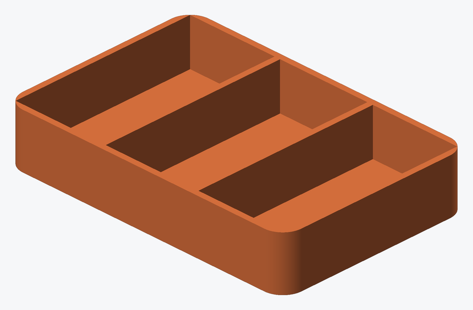
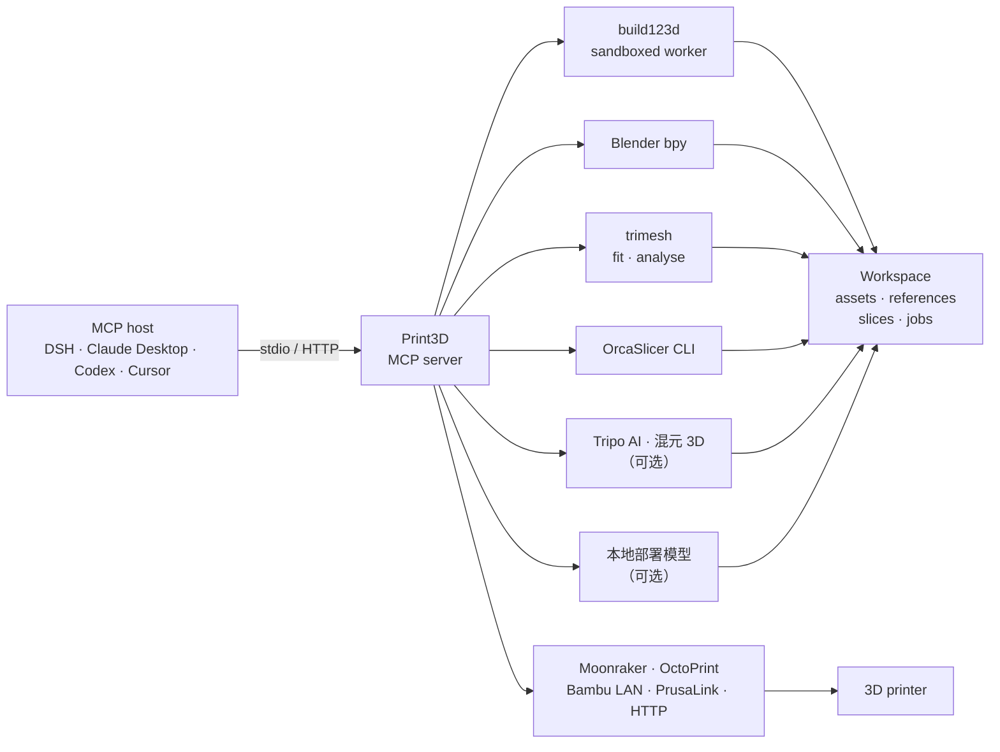

<div align="center">

# Print3D

**Self-hosted 3D printing MCP server — from prompt to printed part.**

把一句话或一张图片，变成打印机上正在跑的零件。
建模、预览、切片、上机，全部通过 MCP 工具完成；模型、G-code 和密钥默认都留在你自己的机器上（云端生成除外）。

[](https://www.python.org/)
[](LICENSE)
[](https://modelcontextprotocol.io/)
[](#状态与限制)

[中文](README.md) · [English](README.en.md) · [快速开始](#快速开始) · [建模路径](#建模路径) · [工具一览](#工具一览) · [配置](#配置) · [安全边界](#安全边界) · [使用手册](docs/MANUAL.md) · [文档](#文档)

</div>



<p align="center"><sub>120 × 80 × 22 mm 三格收纳盘 · 由下方 build123d 脚本生成 · <code>model_preview</code> 渲染</sub></p>

---

## 为什么不是又一个「LLM 建模」脚本

多数 text-to-3D 工具停在「生成一个 mesh」：比例靠猜、单位任意，切片器一打开才发现模型不水密、没有底面、尺寸也放不进热床。

Print3D 把后半段补齐了：

- **尺寸是真实的**：每个模型最终落到毫米。网格会被修复、缩放、贴床，构建结果带 watertight / 包围盒 / 体积检查。
- **过程是可复查的**：每次写入或构建都是一个 revision。脚本、prompt、参考图、几何检查都留在资产里，随时 `model_show` 读回。
- **写操作要确认**：所有改动资产或配置、花钱、上机的动作都要求精确的 `confirm` 串，逐字符比较。
- **默认留在本机**：除显式调用云端生成外，建模、渲染、切片都在本机完成，发送只到你的打印机；密钥只从环境变量或 `secrets.json` 读取。

## 功能

| 能力 | 说明 |
| --- | --- |
| **参数化建模** | 沙箱执行 build123d 脚本，输出 STL + STEP，返回真实几何检查 |
| **多模态入口** | 文字、概念图、手绘草图、现有 STL/GLB/OBJ、Blender bpy 脚本 |
| **模型生成** | 云端：腾讯混元 3D（`hunyuan`）、Tripo AI（`tripo`）；本地部署：命令适配器；本机 Blender：`blender_run` 执行 bpy 脚本生成 mesh |
| **预览** | 带标签的四视图 PNG（iso/front/top/right），可直接贴在对话里；每个资产还有自包含的交互式 HTML 查看器 |
| **工程图** | 从 STEP 投影第三角四视图，输出 SVG / DXF，带虚线隐藏线 |
| **可打印性分析** | 悬垂面积、支撑体积估计、薄壁、热床接触与尺寸、0–100 评分，以及 24 向摆放排序 |
| **切片** | 调用外部 OrcaSlicer CLI，可覆盖层高、填充、墙数、温度、流量、压力提前、线宽、风扇 |
| **打印** | Moonraker（Klipper，Snapmaker U1 实机验证）、OctoPrint、Bambu LAN、PrusaLink、通用 HTTP；支持多工具头与多材料槽 |
| **安全** | 工作区路径沙箱、脚本静态审查 + 子进程资源限额、写操作确认串、密钥脱敏 |

## 架构



Print3D 是一个标准的 MCP server，本身不自带控制台，也不绑定某个模型厂商。宿主（agent）负责写脚本、看预览、决定下一步；Print3D 负责执行和留下可审计的产物。

## 快速开始

### 1. 安装

需要 Python 3.11+、git、[uv](https://docs.astral.sh/uv/)，以及 macOS 或 Linux。切片还需要本机 OrcaSlicer，`blender_run` / `mesh_fit` 还需要本机 Blender；不装仍可建模、预览、导出。

```bash
git clone https://github.com/ThinkArtWork/Print3D.git
cd Print3D
uv sync
uv run print3d init
```

不想自己敲命令？把仓库链接交给能执行命令的 Agent，让它按[使用手册](docs/MANUAL.md) §1.2 的安装提示词代劳。

`print3d init` 会创建 `~/.print3d/`（配置 + 资产目录），不会覆盖已有配置；加 `--force` 才会重写。

### 2. 看一眼能力

```bash
uv run print3d capabilities
```

输出是一份 JSON：`cad.available` 为 `true` 表示 build123d 可用；`providers.cloud[].ready`、`targets`、`printers` 分别表示云端生成、切片目标、打印机是否就绪。**不需要任何 API key，也可以建模、预览和导出。**

### 3. 接入 MCP 宿主

任何支持 stdio 的 MCP 宿主都可以。以常见的 JSON 配置为例：

```json
{
  "mcpServers": {
    "print3d": {
      "command": "/absolute/path/to/Print3D/.venv/bin/print3d",
      "args": ["serve", "--stdio"],
      "env": {
        "PRINT3D_WORKSPACE": "/Users/you/.print3d"
      }
    }
  }
}
```

宿主不会替你 `cd` 到仓库，所以这里用绝对路径。DSH 用户可以直接安装仓库里的 [`dsh-print3d-mcp/`](dsh-print3d-mcp/README.md) bundle，或在 mcp-manager 里填同样的命令；bundle 默认调用 PATH 上的 `print3d`，如果只用 `uv sync` 的虚拟环境，记得把它的 `command` 改成上面的绝对路径。

需要 HTTP 时：

```bash
# 只监听本机回环地址
uv run print3d serve --http

# 从别的机器访问：必须设 token，且不要把端口暴露到公网
export PRINT3D_TOKEN="$(openssl rand -hex 32)"
uv run print3d serve --http --host 0.0.0.0 --port 8765
```

绑定非回环地址却没有 token 时，服务会拒绝启动。

### 4. 做第一件东西

在宿主里说：

> 做一个 120 × 80 × 22 mm 的三格收纳盘，壁厚 2.4 mm，底厚 3 mm，外角 R8。

agent 通常会调用 `model_write` → `model_build` → `model_preview`：先把脚本存成 revision，再在沙箱里执行并拿到水密性/包围盒/体积，最后把四视图 PNG 直接贴回对话。不满意就改脚本，再写一版。

## 模型脚本长什么样

Print3D 不让模型直接吐 STL，而是让它写一段**参数化 build123d 脚本**。脚本有固定契约：

- 脚本开头要 `from build123d import *`
- 必须定义 `def build_part()`，返回一个实体
- 尺寸用毫米；零件底面落在 `z = 0`
- 只能 import `build123d` 和 `math`

上面那张图就是这段脚本：

```python
from build123d import *

PARAMS = {"length": 120, "width": 80, "height": 22, "wall": 2.4, "floor": 3}


def build_part():
    with BuildPart() as part:
        Box(PARAMS["length"], PARAMS["width"], PARAMS["height"],
            align=(Align.CENTER, Align.CENTER, Align.MIN))
        fillet(part.edges().filter_by(Axis.Z), 8)
        with Locations((0, 0, PARAMS["floor"])):
            Box(PARAMS["length"] - 2 * PARAMS["wall"],
                PARAMS["width"] - 2 * PARAMS["wall"],
                PARAMS["height"],
                align=(Align.CENTER, Align.CENTER, Align.MIN),
                mode=Mode.SUBTRACT)
        for x in (-20, 20):
            with Locations((x, 0, PARAMS["floor"])):
                Box(PARAMS["wall"], PARAMS["width"] - 2 * PARAMS["wall"],
                    PARAMS["height"] - PARAMS["floor"],
                    align=(Align.CENTER, Align.CENTER, Align.MIN))
    return part.part
```

`model_build` 的返回值里能看到 `watertight`、`bbox_mm`、`volume_mm3`、`solids`、`faces`、`triangles`、`boundary_edges` 和 `nonmanifold_edges`。构建成功后，STL、STEP 和 `viewer.html` 都会落到该 revision 的目录里。

## 建模路径

**默认路径是文字需求直接到 build123d 脚本，不依赖概念图。** 参考图只是可选输入。

- **文字 → 参数模型（默认）**：`model_write` → `model_build` → `model_preview`。不需要先生成图片。
- **文字 → 概念图 → 参数模型（可选）**：`image_generate` 把文字变成概念图 → `model_write(script, reference=image_path)` → 构建、预览。适合先定造型方向；概念图留在 revision 里，预览时并排返回。
- **参考图 / 草图 → 参数模型（可选）**：`reference_import` 导入图片 → `model_write(reference=...)` → 构建、预览。agent 自己看图写脚本，图片作为来源记录留在 revision 里。
- **图片 / 网格 → 可打印实体**：`mesh_fit` 负责修复、按 `size_mm` 或 `max_dimension_mm` 缩放、居中落地、减面，导出 STL/GLB；`blender_run` 则用 bpy 脚本从零建 mesh。两者最后都可以走 `printability_check`。
- **云端 / 本地生成模型**：`generate_cloud` 调腾讯混元 3D 或 Tripo AI（需要 provider key）；`generate_local` 调你在 `providers.local` 里配置的本地部署命令（不上传云端）。两者都是异步 job；`job_status` 轮询结束后，可再用 `mesh_fit` 定尺寸。
- **STEP 编辑**：先 `model_write` 一段使用 `import_step(INPUT_STEP)` 的脚本，再 `model_build(input="part.step")`。STEP 会被复制进 revision 并暴露为脚本全局 `INPUT_STEP`，适合在现成零件上改结构。

## 切片与打印

切片和打印是可选的，需要先配置 `targets`（OrcaSlicer 预设）和 `printers`。配置方法见[使用手册](docs/MANUAL.md)。

工具参数示意：

```text
slice_plan  asset_id=a_...  target=u1                 # 干跑：解析预设、检查床尺寸、预览参数
slice_run   asset_id=a_...  target=u1  confirm="SLICE a_... u1"
slice_inspect  slice_id=s_...
send        slice_id=s_...  printer_id=u1  confirm="PRINT u1 s_..."
```

- `slice_plan` 不写文件，会打印出 `slice_run` 需要的精确确认串。
- `slice_run` 是异步任务，用 `job_status` 轮询；结束后 `slice_inspect` 看层数、耗材、预计时间与 G-code 路径。
- `send` 前会检查切片成功、G-code 存在、打印机空闲且型号与 target 匹配。默认 `start=true` 立即开印；只想先上传就传 `start=false`。
- 支持 Moonraker（Klipper）、OctoPrint、Bambu LAN、PrusaLink 和通用 HTTP。多工具头/多材料通过 `slots` 按 G-code 工具顺序（T0 起）映射。
- 已实机验证的机型是 **Snapmaker U1**（Moonraker，4 工具头，textured PEI，OrcaSlicer 2.5.0）；其他 Klipper/Moonraker 机器复用同一适配器，换 target / printer id 即可。Bambu LAN 与 PrusaLink 仅做过模拟测试。

## 工具一览

所有会改动资产或配置、调用付费服务或操作打印机的工具都要求 `confirm` 与 schema 完全一致；错了返回 `confirmation_mismatch`，不会产生任何副作用。

| 工具 | 类型 | 作用 | 确认串 |
| --- | --- | --- | --- |
| `capabilities` | 读 | 当前 CAD / 渲染 / 切片 / 打印机 / 密钥就绪状态 | — |
| `system_status` | 读 | 版本、Python、工作区、任务计数 | — |
| `job_status` | 读 | 按 id 查询异步任务 | — |
| `asset_list` | 读 | 列出资产与 revision 数 | — |
| `model_show` | 读 | 读回 manifest、revision 历史与脚本源码 | — |
| `reference_import` | 写 | 把本地图片导入工作区作为参考 | `IMPORT <name>` |
| `image_generate` | 写 | 文生概念图（OpenAI 兼容 images 接口） | `IMAGE <name>` |
| `model_write` | 写 | 保存 build123d 脚本为新 revision | `WRITE <name>` / `WRITE <asset_id>` |
| `model_build` | 写 | 沙箱执行脚本，产出 STL / STEP / viewer | `BUILD <asset_id>` |
| `model_preview` | 读 | 四视图 PNG（只写预览缓存），可连同概念图对比 | — |
| `model_view` | 写 | 生成含全部 revision 的交互式 HTML 查看器 | `VIEW <asset_id>` |
| `model_drawing` | 写 | 第三角四视图工程图，输出 SVG / DXF | `DRAWING <asset_id>` |
| `asset_export` | 写 | 导出 STL / STEP / 脚本 / SVG / DXF 到工作区 | `EXPORT <asset_id>` |
| `blender_run` | 写 | 后台执行 bpy 脚本，导出 STL / GLB | `BLENDER <name>` / `BLENDER <asset_id>` |
| `mesh_fit` | 写 | 修复、缩放、贴床、减面，转成资产 | `FIT <name>` |
| `generate_cloud` | 写 | 腾讯混元 3D / Tripo AI 异步生成 | `CLOUD <name>` |
| `generate_local` | 写 | 运行本地部署的生成命令（`providers.local`） | `LOCAL <name>` |
| `printability_check` | 读 | 悬垂、支撑、薄壁、热床、0–100 评分 | — |
| `orientation_plan` | 读 | 24 向摆放排序与指标 | — |
| `slice_capabilities` | 读 | 切片目标、OrcaSlicer 与预设状态 | — |
| `slice_plan` | 读 | 切片干跑，预览参数与确认串 | — |
| `slice_run` | 写 | 调用 OrcaSlicer 生成 G-code | `SLICE <asset_id> <target>` |
| `slice_inspect` | 读 | 读切片记录、统计与 G-code 路径 | — |
| `printer_list` | 读 | 打印机、适配器、工具头与耗材槽 | — |
| `printer_status` | 读 | 实时状态、文件、进度、温度 | — |
| `printer_save` | 写 | 新增或更新打印机 | `SAVE PRINTER <id>` |
| `printer_remove` | 写 | 删除打印机 | `REMOVE PRINTER <id>` |
| `send` | 写 | 上传 G-code，默认立即开始打印 | `PRINT <printer_id> <slice_id>` |
| `printer_cancel` | 写 | 取消当前打印 | `CANCEL PRINT <printer_id>` |

错误统一为 `{"ok": false, "error": {"code", "message", "hint", "details"}}`。`hint` 是给人和 agent 的下一步提示，`details` 里可能有被拒绝的行号或缺失的产物名。

## 配置

### 工作区

默认 `~/.print3d/`，可用 `PRINT3D_WORKSPACE` 或 `--workspace` 覆盖：

```text
~/.print3d/
├── config.json      # 非敏感配置：providers / targets / printers / server
├── secrets.json     # 可选：API keys（0600）
├── assets/          # 模型资产；每次写入/构建一个 revision
├── references/      # 概念图、参考图
├── slices/          # G-code 与切片记录
├── profiles/        # OrcaSlicer 预设
├── exports/         # asset_export 的默认落点
├── jobs/  logs/  cache/
```

配置优先级：**命令行 > 环境变量 > `config.json` > 默认值**。

### 密钥

推荐用环境变量：

```bash
export TRIPO_API_KEY=...
export HUNYUAN3D_API_KEY=...
export OPENAI_API_KEY=...
```

也可以写 `~/.print3d/secrets.json`（`chmod 600`）：

```json
{"providers": {"tripo": "...", "hunyuan": "...", "openai": "..."}}
```

每个 provider 的 `api_key_env` 可以指定变量名；没配时回退到 `PRINT3D_<ID>_API_KEY`，再回退到 `<ID>_API_KEY`。工具只返回 `has_key`，不会回显密钥。云端生成会把 prompt 或参考图发送给对应服务商。

### 打印机

用 `printer_save` 写入，不必手改 `config.json`：

```json
{
  "printer_id": "u1",
  "adapter": "moonraker",
  "base_url": "http://192.168.1.50:7125",
  "model": "Snapmaker U1",
  "toolheads": 4,
  "confirm": "SAVE PRINTER u1"
}
```

Bambu LAN 的 access code、OctoPrint 的 API key 分别用 `access_code_env` / `api_key_env` 指向环境变量。切片目标（Orca 的 machine / process / filament 预设、床型、材料）写在 `targets.<id>`，完整字段见[使用手册](docs/MANUAL.md) §8.1，U1 的多工具头示例见 §9.1。

## 安全边界

1. **路径沙箱**：除 `reference_import` 读取用户指定图片外，所有文件路径都会解析符号链接后校验；逃出工作区一律 `path_outside_workspace`。`asset_export` 的 `out_path` 也不能借导出覆盖工作区外的文件。
2. **脚本策略 + 执行沙箱**：build123d 脚本先过 AST 审查（导入白名单、禁止 `_` 开头的属性访问、禁止 `eval/exec/open/...`），再在独立子进程里执行，带 RLIMIT_CPU/FSIZE/NOFILE、独立进程组、超时 SIGKILL 和环境变量白名单。静态审查是纵深防御，真正的隔离边界是子进程加资源限额。
3. **写操作必须精确确认**：确认串逐字符比较，错了不写任何文件。
4. **不开放任意 G-code**：只接受切片器产物；发送前检查切片成功、G-code 存在、打印机 idle 且型号匹配。
5. **密钥**：只从环境变量或 `secrets.json`（0600）读取；日志和工具输出统一脱敏；HTTP 模式的 Bearer token 用 `hmac.compare_digest` 比较。
6. **出站下载有上限**：云端模型下载只接受 http(s)，限制重定向次数和体积；HTTP 服务默认只监听回环地址，绑定非回环地址必须设 token。

## 状态与限制

- **Alpha（v0.1.x）**：接口仍可能变化，尚未发布到 PyPI；当前从源码安装；发版使用 GitHub Releases。
- **macOS / Linux**：依赖 POSIX 进程组与 `resource` 限额，Windows 不可用。
- 建模闭环、OrcaSlicer 切片、Moonraker 发送与 Snapmaker U1 真机打印已端到端验证。
- OctoPrint / Bambu LAN / PrusaLink 适配器已实现并有模拟测试；Bambu LAN 与 PrusaLink 尚未做真机验证。
- build123d / OCP 首次安装约 250 MB；Blender 与 OrcaSlicer 是可选的，只在对应路径需要。

## 开发

```bash
uv sync --extra dev
uv run ruff check .
uv run ruff format --check .
uv run pytest -q
```

CI 在 Python 3.11 / 3.13 上跑 ruff、pytest，再构建 wheel 并在干净 venv 里做冒烟测试。欢迎 issue 和 PR；提交前跑一遍上面的命令。

## 文档

- [English README](README.en.md) —— 同一份 README 的英文版
- [使用手册](docs/MANUAL.md) —— 安装、宿主接入、建模路径、切片与上机、配置、故障排查
- [Manual (English)](docs/MANUAL.en.md) —— 使用手册英文版
- [DSH bundle](dsh-print3d-mcp/README.md) —— 把 Print3D 装进 DeepSeek Harness
- [DSH bundle (English)](dsh-print3d-mcp/README.en.md) —— 英文说明

## License

MIT © 2026 ThinkArtWork

## 致谢

建模内核 [build123d](https://github.com/gumyr/build123d) / OpenCascade，网格处理 [trimesh](https://github.com/mikedh/trimesh)，协议层 [MCP Python SDK](https://github.com/modelcontextprotocol/python-sdk)，切片 [OrcaSlicer](https://github.com/OrcaSlicer/OrcaSlicer)，Blender 路径 [Blender](https://www.blender.org/)。
